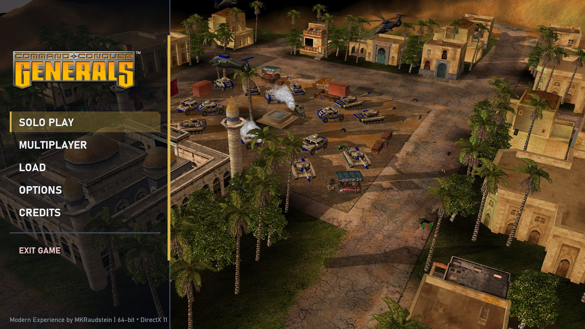
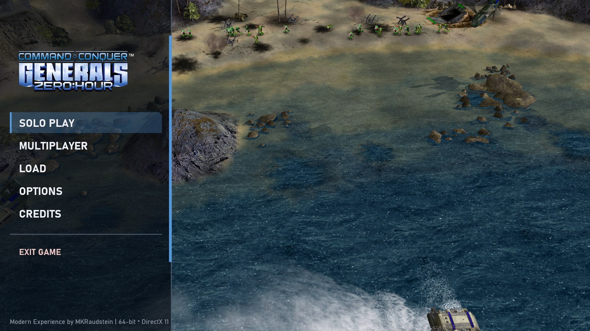
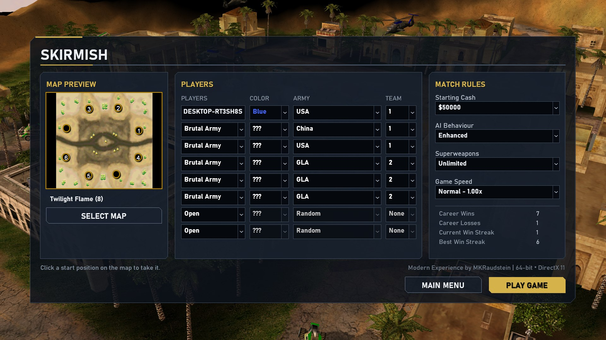
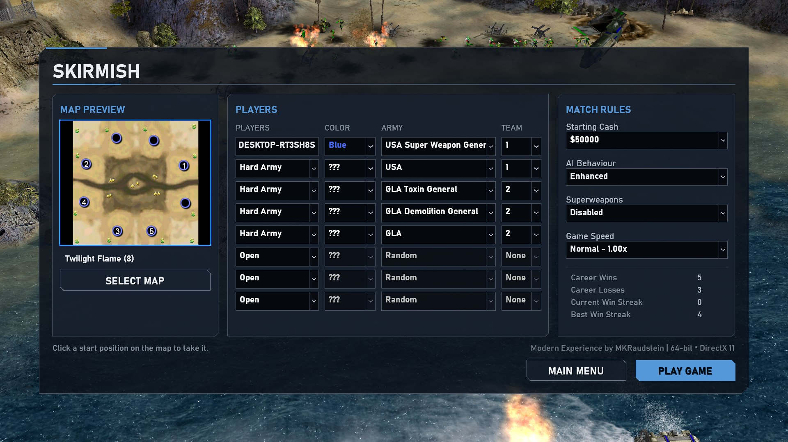
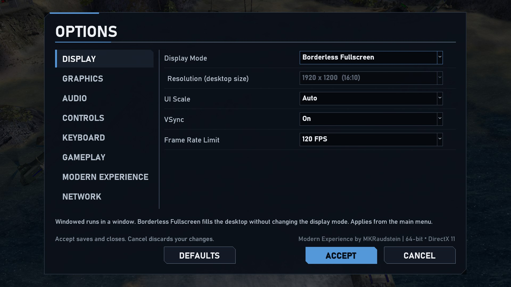
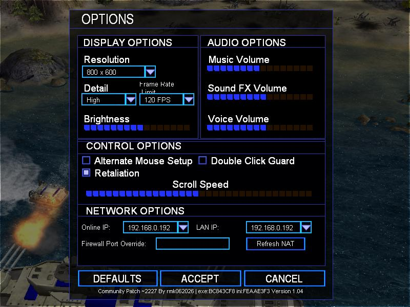

# MKRaudstein Modern Engine

**A 64-bit, DirectX 11 modernization of Command & Conquer: Generals and Zero Hour, with an optional Modern Experience and the original game one switch away.**

[](docs/DEVELOPER_PREVIEW.md)
[](docs/modernization/PROJECT_STATUS.md)
[](#whats-the-state-of-each-title)
[](#whats-the-state-of-each-title)
[](docs/DEVELOPER_PREVIEW.md)
[](https://github.com/martinkraud/GeneralsGameCode/actions/workflows/repo-checks.yml)
[](LICENSE.md)

> An independent fork of [TheSuperHackers/GeneralsGameCode](https://github.com/TheSuperHackers/GeneralsGameCode). **This repository contains source code and tooling only: it does not contain, and the project does not distribute, any Electronic Arts game asset.** You need your own legitimate copy of the game.

<table align="center">
  <tr>
    <td align="center" width="50%"><br><b>Generals</b>: warm gold accent</td>
    <td align="center" width="50%"><br><b>Zero Hour</b>: cold blue accent</td>
  </tr>
</table>

<p align="center"><sub>One Modern Experience design family: the same layout, typography and components; only the title accent differs. Real captures of the final builds (1920&times;1080, Auto UI scale).</sub></p>

## What is this?

The original games were built for 32-bit Windows, Direct3D 8 and 800x600 screens. This project ports the engine to **native 64-bit Windows with a Direct3D 11 renderer**, adds support for modern displays (4:3 to 32:9, high refresh rates, UI scaling) and offers an **optional Modern Experience**: a redesigned frontend, Options and Skirmish setup, an Enhanced in-game HUD and a few opt-in match rules. The original simulation stays authoritative and unchanged: **Modernize Generals, not replace its identity.**

## The questions people ask first

| Question | Short answer |
|---|---|
| **What does it do today?** | Both **Generals** and **Zero Hour** run as native 64-bit Direct3D 11 games on Windows: menus, Skirmish against the AI, save/load and replays, audio, all three base factions with the Enhanced HUD. |
| **What is Modern Experience?** | The optional modern layer: responsive menu and Options (8 pages, help for every setting, read-only keyboard reference), Skirmish **Match Rules** (Starting Cash, AI Behaviour Original / Enhanced, Superweapons, Game Speed Slow-Normal-Fast-Very Fast), smooth unit motion, Enhanced HUD. It is the default of the 64-bit runtime. |
| **What is Classic?** | `-classic` starts the original frontend and behaviour of the game, with none of the Modern screens, rules or HUD. Gameplay rules are identical in both: the simulation is the original 30 ticks per second logic, deterministic, with presentation decoupled from it. |
| **What works, what is still in progress?** | See [Development status](#development-status). Open: real two-PC multiplayer validation, Modern LAN screens, multiplayer Game Speed, movie playback, key rebinding. |
| **What do I need to run it?** | Windows 10/11 64-bit, a Direct3D 11 GPU and your own **Steam copy of Generals and/or Zero Hour** (English). The Developer Preview package needs no Visual Studio, CMake, Python or repository. |
| **Is it released?** | **Developer Preview** (testing build), not a public release. [Player guide](docs/DEVELOPER_PREVIEW.md). |
| **Does this repository contain game assets?** | **No.** No archive, media, texture, map or modified copy of EA data. Where the project needs a derived data file, the installer generates it on your PC from your own files. [Distribution](docs/modernization/DISTRIBUTION.md). |
| **Where are the technical details?** | [Documentation](#documentation) below; the authoritative roadmap is [docs/PRODUCT_ROADMAP.md](docs/PRODUCT_ROADMAP.md). |

## Try the Developer Preview

1. Own and install **Generals** and/or **Zero Hour** on Steam.
2. Take the package of your game (`MKRaudstein-<Title>-DeveloperPreview-<commit>.zip`) from the packaging output of `scripts/native-runtime/New-MKRaudsteinDistribution.ps1` (there is no public download page yet), extract it and run **`Install.cmd`**. It checks your installation, backs up what it replaces, installs and verifies.
3. Press PLAY in Steam. Add `-classic` to the launch options for the original frontend. `MKRaudstein\Uninstall.cmd` in the game folder restores the original files; Steam *Verify integrity of game files* is the fallback.

Full guide, limitations and troubleshooting: **[docs/DEVELOPER_PREVIEW.md](docs/DEVELOPER_PREVIEW.md)**.

## Development status

State vocabulary: **Done** = implemented and validated as stated; **Owner accepted** = reviewed by the project owner on a native desktop; **Pending** = a named validation is still open; **Future** = not started. No percentages: the states mirror [docs/PRODUCT_ROADMAP.md](docs/PRODUCT_ROADMAP.md).

| Area | State |
|---|---|
| Native AMD64 (Generals, Zero Hour) | Done |
| Direct3D 11 renderer | Done |
| Modern resolutions, ultrawide (4:3 - 32:9), UI scaling | Done |
| Smooth high-refresh presentation (simulation stays 30 TPS) | Done |
| Classic preservation (`-classic`, original rules, golden determinism gates) | Done |
| Modern Experience UI (menu, Options, Skirmish setup, Load / Replay) | Done, **owner accepted** |
| Enhanced AI (opt-in per match) | Done (experimental; Original AI is the default) |
| Match Options (Starting Cash, AI Behaviour, Superweapons) | Done, **owner accepted** |
| Game Speed (Skirmish) | Done, **owner accepted** (multiplayer: not implemented) |
| Settings / UX | Done, **owner accepted** (Controls scrolling fixed in the Developer Preview milestone) |
| Developer Preview package, installer, uninstaller | Done (automatically validated on the developer PC) |
| Player-package install, Steam play and uninstall (owner manual test, both titles) | **Owner accepted** (Generals and Zero Hour) |
| Real clean-machine validation of the package | **Pending** (a machine without the developer tools has not been established) |
| Multiplayer (LAN) validation between two PCs | **Pending** |
| Modern LAN lobby, multiplayer Game Speed, protocol compatibility check | Future |
| Public Alpha, Beta, Release Candidate, 1.0 | Future |

### What's the state of each title?

* **Generals**: full Skirmish path on the native engine; campaign progression and movie playback are incomplete; the Zero-Hour-style special-power sidebar extension is generated at install time from your own archives.
* **Zero Hour**: Skirmish human-tested on a desktop and a laptop; multiplayer, campaign progression, movies and long-session endurance are not fully validated.
  The Modern Experience uses a cold blue accent here (Generals: warm gold); the Modern in-game HUD for Zero Hour (14-slot command grid, all generals) is implemented after Developer Preview 1 and awaits the owner's acceptance ([details](docs/modernization/ZERO_HOUR_MODERN_HUD.md)).

Details and known issues: [PROJECT_STATUS.md](docs/modernization/PROJECT_STATUS.md).

## Roadmap in one line

**Developer Preview → Public Alpha → Beta → Release Candidate → 1.0.** Gates for each stage (including the two open validations above) are in [docs/PRODUCT_ROADMAP.md](docs/PRODUCT_ROADMAP.md), which is authoritative; the phase list further down this page is the engineering history.

## Screenshots

| Skirmish setup: Generals | Skirmish setup: Zero Hour |
|---|---|
|  |  |

| Modern Experience Options (Zero Hour) | Classic frontend (same game, `-classic`) |
|---|---|
|  |  |

More: [UI evidence](docs/modernization/evidence/) (4:3, 21:9 and 32:9 layouts).

## Legal and positioning

* This is an **independent modernization project**, not affiliated with or endorsed by Electronic Arts. "Command & Conquer", "Generals" and "Zero Hour" are trademarks of Electronic Arts Inc.
* The source code is released under the **GPL-3.0 with the additional terms of the original Electronic Arts source release** (see [LICENSE.md](LICENSE.md)). Project-created code and binaries are separate from the retail game content.
* You must own a legitimate, compatible copy of the game. The project distributes **no** proprietary game asset; its packages contain only the project's own binaries, scripts and documentation, and a validation gate fails if anything else appears.

---

## Documentation

| For | Start here |
|---|---|
| Playing the Developer Preview | [Player guide](docs/DEVELOPER_PREVIEW.md) |
| How the package, installer and uninstaller work and are validated | [Distribution architecture](docs/modernization/DISTRIBUTION.md) |
| What changed, by area | [CHANGELOG.md](CHANGELOG.md) |
| Current status: completed / in progress / planned / known issues | [docs/modernization/PROJECT_STATUS.md](docs/modernization/PROJECT_STATUS.md) |
| Product roadmap (Current -> Developer Preview -> Alpha -> Beta -> RC -> 1.0) and the Modern UI product-completion audit | [roadmap](docs/PRODUCT_ROADMAP.md), [UI audit](docs/modernization/MODERN_UI_PRODUCT_COMPLETION.md) |
| Modern Experience UI: archaeology of the retail UI and the target architecture | [archaeology](docs/modernization/MODERN_UI_ARCHAEOLOGY.md), [architecture and phases](docs/modernization/MODERN_UI_ARCHITECTURE.md) |
| Settings, Options and the keyboard reference | [Modern Settings](docs/modernization/MODERN_SETTINGS_ARCHITECTURE.md) |
| Game Speed (Skirmish): original facts, architecture, supported speeds and evidence | [Game Speed](docs/modernization/GAME_SPEED.md), [retail audit](docs/modernization/RETAIL_GAME_SPEED_AUDIT.md), [original design](docs/modernization/GAME_SPEED_DESIGN.md) |
| Performance methodology and results | [docs/PERFORMANCE.md](docs/PERFORMANCE.md) |
| Engineering findings (what was wrong, where, how it was verified) | [docs/findings/README.md](docs/findings/README.md) - [performance](docs/findings/PERFORMANCE_FINDINGS.md), [AMD64 porting](docs/findings/AMD64_PORTING_FINDINGS.md), [replay / determinism](docs/findings/REPLAY_DETERMINISM_FINDINGS.md) |
| Roadmap, milestone records and handoff | [docs/modernization/](docs/modernization/) - [handoff](docs/modernization/AGENT_HANDOFF.md) |
| Building | [Building](#building) below |
| Known limitations | [Known Incomplete Areas](#known-incomplete-areas) below |

---

## Project background

This repository builds on the community-driven [TheSuperHackers/GeneralsGameCode](https://github.com/TheSuperHackers/GeneralsGameCode) project. The goal of this fork is not to turn Generals into a different game: it is to make the original game work correctly on a modernized engine first, while creating a foundation for optional modern presentation and future expansion. The modernization deliberately separates:

1. **Original game preservation**
2. **Engine modernization**
3. **Optional Modern Experience features**
4. **Future gameplay/content expansion**

<details>
<summary>Detailed capability list of the native engine (Generals)</summary>

Native 64-bit Windows executable, normal startup, original asset loading, original INI / WND parsing, Direct3D 11 presentation and world rendering, original frontend and Main Menu, Solo Play / Skirmish setup, map loading, live GameLogic, AI players, selection and commands, buildings and production, ground units, aircraft, projectiles, terrain, scenery, trees and props, roads and bridges, water and shorelines, shroud, shadows, particles and effects, radar, command bar, General powers, audio, edge scrolling, save / load, Skirmish victory and return to the frontend, repeated match startup.

A normal Generals gameplay path runs through `Startup → Main Menu → Skirmish → Map Load → Gameplay → Victory / Exit` on the native AMD64 / D3D11 engine. Zero Hour runs on the same engine.

</details>

---

# Original Experience

Preserving the original game is a core requirement.

The modernization is not intended to silently alter game balance, simulation
rules or the identity of Generals.

The original gameplay simulation remains authoritative.

Examples of preservation priorities include:

- Original unit behaviour
- Original economy
- Original combat rules
- Original build times
- Original damage values
- Original faction behaviour
- Original General powers
- Original campaign behaviour
- Original simulation timing

Unexpected or unusual retail values are not automatically treated as bugs.

Where optional modern features are introduced, the original behaviour remains
the reference and compatibility target.

---

# Modern Experience

Alongside preservation, the project provides an optional **Modern Experience**
for improvements that do not need to redefine the underlying game.

Current Modern Experience work includes:

- Modern display handling
- Widescreen support
- Ultrawide support
- UI scaling
- Modernized Options interface: eight pages with a help line for every setting, a read-only keyboard-shortcut reference and Accept / Cancel semantics (see [Modern Settings](docs/modernization/MODERN_SETTINGS_ARCHITECTURE.md))
- Improved frontend layout
- Skirmish match options: Starting Cash, AI Behaviour (Original / Enhanced), a Superweapons limit and Game Speed (Slow / Normal / Fast / Very Fast; pacing only, independent of FPS, Normal = original speed)
- Smooth unit presentation
- Optional Enhanced gameplay interface (USA, China, GLA)

The guiding design principle is:

> **Modernize Generals, not replace its identity.**

### Where the Modern UI is going

The retail interface is built on 800x600-era windows. Modern Experience keeps
that content and atmosphere but replaces the fixed layout with a responsive,
extensible one (reusable layout components, a real Match Setup screen, a
Modern HUD) so new options never again have to be squeezed into unused pixels.
Original / `-classic` remains the preservation path. The investigation and the
phased plan are in
[MODERN_UI_ARCHAEOLOGY.md](docs/modernization/MODERN_UI_ARCHAEOLOGY.md) and
[MODERN_UI_ARCHITECTURE.md](docs/modernization/MODERN_UI_ARCHITECTURE.md).

The project asks what Generals might look and feel like if its original design
team were adapting it for modern hardware and displays today.

---

# Modern Display Support

The modernized engine supports display geometries far beyond the original
4:3-era assumptions.

Development and layout validation includes resolutions and aspect ratios such
as:

- 800×600
- 1920×1080
- 1920×1200
- 2560×1440
- 3440×1440
- 5120×1440

This includes support for:

- 16:9
- 16:10
- 21:9
- 32:9 ultrawide
- unusual intermediate display sizes
- scalable UI geometry

Modern UI elements are designed to remain bounded rather than stretching
proportionally across extremely wide displays.

Additional display work remains planned, including further fullscreen,
refresh-rate and runtime display handling improvements.

---

# Simulation and Smooth Presentation

Generals gameplay simulation remains authoritative at its intended simulation
rate.

Rendering is treated separately.

This allows modern displays to render substantially more frequently without
making the game simulation run faster.

The engine now includes an optional **Smooth** presentation mode.

Current interpolation work includes:

- Ground-unit movement
- Aircraft movement
- Projectile movement
- Heading interpolation
- Turret yaw
- Barrel pitch

The simulation itself remains authoritative.

Interpolation is presentation-only and contains safeguards for events such as:

- Large relocations
- Teleports
- Load transitions
- Invalid history
- Simulation gaps
- Epoch changes

The objective is smooth visual motion on modern high-refresh displays without
changing the underlying gameplay.

---

# Performance

The performance work is **not** about maximising render FPS. The original game simulates **30 logic ticks per second** at Normal speed (a 33.333 ms budget per tick, proven for both
Generals and Zero Hour in the [Game Speed audit](docs/modernization/RETAIL_GAME_SPEED_AUDIT.md)); rendering is paced separately in this fork. The CPU work targets a **stable simulation in
large battles**: the slowest ticks (p99 / worst), ticks that exceed the 33.333 ms budget, derived deadline misses and accumulated backlog - not the average, which is already small.

All optimizations are exact (bit-identical simulation): each keeps the original algorithm selectable, was checked against it, and left the deterministic benchmark fingerprint unchanged.

**Current baseline** (the reference for regression tests; one development laptop, Intel Core Ultra 5 125U; headless, deterministic, 13 minutes = 23 400 ticks of Twilight Flame, 4 Hard AI, Enhanced AI, 50 000 cash; median of three runs, tick time in ms):

| workload | mean | p50 | p99 | p99.9 | ticks over the 33.3 ms budget (of 23 400) |
|---|---|---|---|---|---|
| Zero Hour, realistic heavy match | 2.75 | 1.64 | 18.6 | 26.4 | 9 |
| Zero Hour, stress (4x mobile units) | 4.31 | 1.98 | 21.7 | 32.9 | 22 |
| Generals, realistic heavy match | 0.78 | 0.64 | 5.0 | 9.8 | 6 |
| Generals, stress (4x mobile units) | 1.40 | 0.77 | 10.1 | 17.1 | 0 |

Zero Hour keeps its p99 inside the budget up to about 2 700 - 2 900 simultaneous objects (a normal heavy match peaks near 1 500). Every optimization is exact (bit-identical simulation, guarded by determinism digests and golden AI gates), and the
graphical client plays the same seeded replay as the headless run (state fingerprints equal at every checkpoint). The largest remaining cost is Zero Hour's HUNT-state path searches that exhaust the engine's shared path-cell pool (about a quarter
of its simulation time); it needs a behaviour decision, not an exact optimisation, and is a Beta target. The broad performance phase is closed: [docs/modernization/PERFORMANCE_FINAL_AUDIT.md](docs/modernization/PERFORMANCE_FINAL_AUDIT.md).
These numbers describe this workload on this machine and should not be generalised to other PCs, maps or match types.

Methodology, the per-milestone A/B tables, the current profile and the limits of these results: **[docs/PERFORMANCE.md](docs/PERFORMANCE.md)**. Reusable root-cause write-ups for other engine developers:
**[docs/findings/](docs/findings/README.md)**.

---

# Enhanced Gameplay UI

An optional **Enhanced** gameplay interface is available for the three base
Generals factions: USA, China and GLA.

This is separate from the Original presentation.

The architecture follows:

- **Original** — preservation of the classic Generals interface
- **Enhanced** — modernized presentation using the same gameplay systems

The Enhanced interface does not duplicate command or simulation logic.

Instead, it presents existing gameplay functionality through a modernized
layout shared by every faction:

- A centered bottom HUD island
- Open battlefield space on both sides
- Modern responsive geometry
- Improved radar presentation
- Improved unit information
- Clear command/build grouping
- Dedicated cash and power presentation
- General rank and XP presentation
- A General Powers console built from the game's real power data
- Ultrawide-safe layout
- UI-scale support

Each faction has its own construction language (USA precision-machined,
China heavy industrial, GLA improvised field equipment) on top of the shared
functional structure. Further faction-specific visual polish is planned for a
later pass.

---

# Rendering Strategy

This project does **not** implement a generic Direct3D 8 emulation device.

Instead, original rendering semantics are migrated into backend-neutral or
purpose-built Direct3D 11 systems.

The fidelity target is:

> Preserve the original visual intent, assets and rendering behaviour while
> implementing equivalent modern rendering systems.

The project does not require bit-identical Direct3D 8 raster output.

Visual equivalence, gameplay readability and preservation of the original
artistic intent are the priorities.

The original renderer and original game remain important references during
modernization.

---

# Current Feature Status

| Area | Status |
| --- | --- |
| Native AMD64 executable | ✅ Working |
| Normal Generals startup | ✅ Working |
| Original asset loading | ✅ Working |
| Direct3D 11 presentation | ✅ Working |
| Direct3D 11 world rendering | ✅ Working |
| Original Main Menu | ✅ Working |
| Mouse / keyboard input | ✅ Working |
| Skirmish setup | ✅ Working |
| Map loading | ✅ Working |
| Live GameLogic | ✅ Working |
| AI gameplay | ✅ Working |
| Terrain | ✅ Working |
| Units / buildings | ✅ Working |
| Aircraft / projectiles | ✅ Working |
| Trees / scenery | ✅ Working |
| Roads / bridges | ✅ Working |
| Water / shorelines | ✅ Working |
| Fog / shroud | ✅ Working |
| Shadows | ✅ Working |
| Particles / effects | ✅ Working |
| Radar / command interface | ✅ Working |
| Audio | ✅ Working |
| Save / Load | ✅ Working |
| Modern resolutions | ✅ Working |
| Ultrawide support | ✅ Working |
| UI scaling foundation | ✅ Working |
| Smooth presentation | ✅ Working, optional |
| Performance instrumentation | ✅ Working |
| Simulation CPU optimization (exact, serial) | ✅ Delivered, see [Performance](docs/PERFORMANCE.md) |
| Enhanced HUD (USA, China, GLA) | ✅ Working, optional |
| Movies / cutscenes | 🚧 Incomplete |
| Replay record / re-simulate (Generals Skirmish) | ✅ Verified for a recorded match; wider validation needed |
| Multiplayer / determinism | ⏳ Further validation needed |
| Zero Hour native gameplay | ✅ Working, human-tested on desktop and laptop; broader (multiplayer, campaign, endurance) validation continues |
| Skirmish match rules (Starting Cash, AI Behaviour, Superweapons, Game Speed) | ✅ Working, optional (Original/defaults preserved; `-classic` hides them); Game Speed is Skirmish-only, multiplayer Game Speed is not implemented |
| Enhanced AI (opt-in per match) | 🚧 Experimental; development paused while the Modern UI is built, Original AI is the default and is gate-protected |
| Developer Preview package, installer and uninstaller (Generals + Zero Hour) | ✅ Built and validated by script on the developer PC (installer with backup / rollback, uninstaller, no game assets redistributed); a real clean-machine run is pending ([player guide](docs/DEVELOPER_PREVIEW.md), [distribution](docs/modernization/DISTRIBUTION.md)) |
| Modern Experience frontend: design system, main menu, Options (8 pages), Skirmish Match Setup, Load Game / Replays, dialogs, Credits (both titles; LAN lobby, Online, Challenge select and Map select stay retail) | ✅ Owner accepted on a native desktop ([UI.3](docs/modernization/MODERN_UI_3_FRONTEND.md), [Settings](docs/modernization/MODERN_SETTINGS_ARCHITECTURE.md)) |
| In-game Modern HUD for the new frontend language | ⏳ Planned ([architecture](docs/modernization/MODERN_UI_ARCHITECTURE.md)); the Enhanced HUD framework v1 is unchanged |

---

# Generals and Zero Hour

The modernized engine is shared by both games.

## Command & Conquer: Generals

Generals is currently the primary native validation target.

Most major AMD64, renderer and Modern Experience milestones are therefore
validated in Generals first.

## Command & Conquer: Generals – Zero Hour

Zero Hour now runs on the same native AMD64/D3D11 engine and has been played
through Skirmish on the project's tested desktop and laptop systems, with the
Enhanced HUD for all three base factions.

Zero Hour keeps its own validation track: its content, shell, Challenge mode
and generals' powers differ from Generals. Multiplayer, campaign progression,
movies and long-session endurance are not yet fully validated. See
[PROJECT_STATUS.md](docs/modernization/PROJECT_STATUS.md).

---

# Engineering phases (history)

> The **product roadmap** - Developer Preview → Public Alpha → Beta → Release Candidate → 1.0, with the gates of each stage - is [docs/PRODUCT_ROADMAP.md](docs/PRODUCT_ROADMAP.md) and is authoritative. The phase list below is the engineering history of how the native engine was brought up; it is not a second roadmap.

## Phase 1 — Native Engine Foundation

- [x] Native AMD64 builds
- [x] Win64 startup
- [x] Direct3D 11 backend foundation
- [x] Backend-neutral rendering groundwork
- [x] Simulation/render timing separation

## Phase 2 — Original UI and Frontend

- [x] Direct3D 11 presentation
- [x] Render2D
- [x] Original UI textures
- [x] Original fonts
- [x] Original Main Menu
- [x] Mouse and keyboard input
- [x] Interactive Skirmish setup

## Phase 3 — Native Game Integration

- [x] Map loading
- [x] Live GameLogic
- [x] AI simulation
- [x] Selection and commands
- [x] Production
- [x] General powers
- [x] Save / Load
- [x] Normal startup path
- [x] Normal gameplay lifecycle

## Phase 4 — Direct3D 11 World Rendering

- [x] Terrain
- [x] Static meshes
- [x] Units and buildings
- [x] Aircraft
- [x] Projectiles
- [x] Trees and props
- [x] Roads and bridges
- [x] Water and shorelines
- [x] Shroud
- [x] Shadows
- [x] Particles and effects
- [x] Radar
- [x] Complete playable world frame

Further fidelity and correctness improvements remain ongoing.

## Phase 5 — Modern Display and Presentation

- [x] Modern resolution handling
- [x] Widescreen layouts
- [x] Ultrawide layouts
- [x] UI scaling foundation
- [x] Modern Options architecture
- [x] Simulation/render separation
- [x] Optional Smooth unit presentation
- [ ] Further fullscreen handling
- [ ] Refresh-rate controls
- [ ] Key rebinding

## Phase 6 — Performance

- [x] Performance instrumentation
- [x] Frame-time attribution
- [x] Renderer profiling
- [x] Evidence-driven optimization foundation
- [x] Large-game simulation profiling (deterministic AI-vs-AI benchmark)
- [x] Exact serial CPU optimizations (ZoneCalc, A* open list and line walk, launch-log flush, staged HUNT scan)
- [x] Seeded, fingerprint-verified graphical benchmark and final performance baseline for both titles
- [x] Performance-phase exit audit ([PERFORMANCE_FINAL_AUDIT.md](docs/modernization/PERFORMANCE_FINAL_AUDIT.md))
- [ ] Zero Hour HUNT failing-search chain and first-use render hitch (Beta targets)
- [ ] Heavy real-combat profiling with a human player

## Phase 7 — Enhanced Experience

- [x] Original / Enhanced interface architecture
- [x] USA Enhanced HUD foundation
- [x] USA HUD visual refinement
- [x] China Enhanced HUD
- [x] GLA Enhanced HUD
- [ ] Cross-faction Enhanced HUD polish and final artwork
- [ ] Further graphics enhancements
- [ ] Higher-quality optional visual assets

## Phase 7b — Modern Experience UI (in progress)

- [x] UI archaeology and responsive layout foundation (UI.1)
- [ ] Main frontend / navigation shell (UI.2) - implemented, redrawn by UI.3, awaiting native acceptance
- [x] Modern frontend design system, Match Setup, Options, Load / Replay, dialogs, Credits (UI.3) - visual direction approved by the owner (2026-11-06); Match Options + Game Speed accepted (2026-11-07); Settings / UX completion implemented, owner review of the new Options pages pending
- [ ] Remaining retail frontend screens (LAN lobby, Online, Challenge select, Map select) (UI.4) - audited and ranked in the UI audit; the LAN setup waits for real two-PC validation
- [ ] Modern in-game HUD for USA / China / GLA (UI.5)
- [ ] Resolution / scaling matrix, polish and native acceptance (UI.6)

Active performance optimization and Enhanced AI development are paused while
this phase runs; their regression gates stay in force.

## Phase 8 — Compatibility Completion

- [ ] Movies / cutscenes
- [ ] Broader replay validation
- [ ] Multiplayer validation
- [ ] Determinism validation
- [ ] Full Zero Hour native gameplay validation
- [ ] Remaining renderer fidelity issues

## Phase 9 — Extended Game

Only after the original games are sufficiently stable on the modernized
engine may the project provide a foundation for larger optional expansion.

Possible future work includes:

- New factions
- New units and buildings
- New maps
- New campaigns
- Expanded AI
- Larger battles
- New gameplay systems
- Additional graphics features

Potential future factions include:

- Europe
- Russia

These are long-term concepts and are deliberately separated from the current
Generals and Zero Hour preservation work.

---

# Original vs Enhanced

The project deliberately avoids forcing every modernization feature onto the
original presentation.

## Original

The preservation path.

Its purpose is to retain the recognizable original Generals experience as
closely as practical on the modernized engine.

## Enhanced

An optional modern presentation layer.

Enhanced may provide:

- Modernized HUD layouts
- Improved information hierarchy
- Higher-quality UI assets
- Improved graphics options
- Additional visual improvements

Enhanced should still unmistakably look and feel like **Command & Conquer:
Generals**.

Gameplay changes are not automatically part of Enhanced presentation.

---

# AI-Assisted Development

This modernization project makes extensive use of **AI coding agents** as part
of the development workflow.

AI agents are used for tasks including:

- Source-code and engine analysis
- C++ implementation
- Refactoring
- Renderer migration
- Automated testing
- Build diagnostics
- Runtime diagnostics
- Regression investigation
- Performance analysis
- Technical documentation

The project is directed and reviewed by **Martin Raudstein / MKRaudstein**.

Project goals, compatibility requirements, architecture priorities and
acceptance criteria are human-directed.

AI-generated code is **not considered correct solely because an agent produced
it**.

Changes are validated through combinations of:

- Automated tests
- AMD64 builds
- Win32 builds
- Generals and Zero Hour build validation
- Reference-behaviour comparisons
- Runtime diagnostics
- Preserved evidence
- Performance measurements
- Regression checks
- Manual native-game testing
- Human visual and behavioural acceptance

AI agents may autonomously investigate and implement bounded technical work
within established project constraints.

Native game execution, major architectural decisions and acceptance of
significant runtime or visual milestones remain human-controlled.

The project therefore follows a:

> **Human-directed, AI-assisted development model.**

---

# Development Approach

Modernization is performed incrementally.

Original behaviour is first understood and preserved before or while the
underlying implementation is replaced.

Major milestones typically separate:

1. Source and architecture analysis
2. Implementation
3. Automated regression testing
4. AMD64 validation
5. Win32 preservation validation
6. Isolated native candidate staging
7. Manual native-game testing
8. Evidence preservation
9. Human acceptance

A successful build or automated rendering test is not automatically considered
a successful native milestone.

Machine validation and human visual/behavioural validation are deliberately
treated as separate acceptance criteria where appropriate.

Detailed engineering notes, audits, profiling data, runtime evidence and
milestone documentation are maintained under:

`docs/modernization/`

The root README is intended to describe the public state and direction of the
project rather than act as a detailed engineering changelog.

---

# Branches

## `main`

The `main` branch serves as the stable/upstream-compatible baseline.

Experimental Modern Engine features should not be assumed to exist there.

## `dev/modern-engine`

This is the active modernization branch.

It contains the current:

- AMD64 engine work
- Direct3D 11 renderer
- Modern Experience
- performance work
- Modern Display / Settings completion

Major modernization work remains here while systems are still being developed
and validated.

---

# Building

The upstream project supports multiple build configurations.

This modernization branch currently performs its primary native engine work
and runtime validation on Windows.

## Standard Win32 Build

```bash
cmake --preset win32
cmake --build --preset win32
```

## Native AMD64 / Direct3D 11 Build (the modernized engine)

```bash
cmake --preset win64
cmake --build --preset win64 --target g_generals z_generals
```

This produces `generalsv.exe` (Generals) and `generalszh.exe` (Zero Hour) under `build/win64/`. They run against a *staged copy* of your own game data, never against the Steam
installation: see `scripts/native-runtime/` (`Stage-NativeInitOnly.ps1`, `Run-ZeroHourCandidate.ps1`) and, for a ZIP that can be extracted over a legitimate installation,
`scripts/native-runtime/New-MKRaudsteinDistribution.ps1` (the overlay ZIPs and the Developer Preview player packages with installer / uninstaller, symbols and SHA-256 sums, newest two kept; see [DISTRIBUTION.md](docs/modernization/DISTRIBUTION.md)). Tests: `g_googletest` / `z_googletest` targets and the Python suites under `scripts/`.
Disk use of the staging and benchmark tools is bounded ([DISK_RETENTION.md](docs/modernization/DISK_RETENTION.md)).

The repository uses a vcpkg manifest (`vcpkg.json`) for dependency management.

The experimental AMD64/D3D11 runtime uses its own staging and validation
workflow.

Do not assume that the normal Win32 installation workflow represents the
current AMD64 development runtime.

Detailed modernization build, staging and runtime information is maintained in
the repository documentation and scripts.

For upstream build information, see the
[GeneralsGameCode build guides](https://github.com/TheSuperHackers/GeneralsGameCode/wiki/build_guides).

---

# Running the Game

Original **Command & Conquer: Generals** and **Zero Hour** game data is still required, and this repository does not provide it. You must own a legitimate copy (the Steam release, English, is the supported one).

* **To play the Developer Preview** (a testing build, not a public release): follow the [player guide](docs/DEVELOPER_PREVIEW.md). Extract the package of your game and run `Install.cmd`; it replaces only `Generals.exe` and adds the app-local runtime DLLs after backing up what it replaces, and `MKRaudstein\Uninstall.cmd` removes it again.
* **To develop**: the development runtime workflows are deliberately isolated (a *staged copy* of your game data under `build/dev-runtimes/`), so modernization testing never replaces the executables of your installed game.

---

# Known Incomplete Areas

Although Generals is now playable on the modernized engine, development is not
complete.

Important remaining areas include:

- Movie / cutscene playback
- Full replay validation (a recorded Generals Skirmish re-simulates; Zero Hour, campaign and cross-version replays are not validated)
- Multiplayer validation (real two-PC validation of the latest multiplayer smoothness work is still pending)
- Determinism validation
- Broader Zero Hour validation (multiplayer, campaign, endurance)
- Additional renderer fidelity work
- Some shadow correctness/fidelity cases
- Further display controls
- Key rebinding (the retail engine has none; Modern Options shows the bindings read-only)
- Real clean-machine validation of the Developer Preview package and real two-PC multiplayer validation
- Cross-faction Enhanced HUD polish
- Beta-level performance polish (see the performance section; no known performance release blocker)
- Additional Modern Experience polish

The presence of a feature in the native engine should not automatically be
interpreted as final release-quality implementation.

---

# Upstream Project

This work is based on:

**TheSuperHackers / GeneralsGameCode**

https://github.com/TheSuperHackers/GeneralsGameCode

The upstream project is a community-driven effort to fix and improve
*Command & Conquer: Generals* and *Command & Conquer: Generals – Zero Hour*.

The complementary upstream game-data project is:

**TheSuperHackers / GeneralsGamePatch**

https://github.com/TheSuperHackers/GeneralsGamePatch

It focuses on game data and assets including INI scripts, GUI, AI, maps,
models, textures, audio and localization.

This modernization fork should **not** be interpreted as the official
development direction, status or release plan of TheSuperHackers or the
upstream GeneralsGameCode project.

---

# Contributing

For information about the upstream project, see:

- [CONTRIBUTING.md](CONTRIBUTING.md)
- [GeneralsGameCode Wiki](https://github.com/TheSuperHackers/GeneralsGameCode/wiki)
- [TheSuperHackers/GeneralsGameCode](https://github.com/TheSuperHackers/GeneralsGameCode)

Modernization-specific engineering documentation is available under:

`docs/modernization/`

Because the Modern Engine branch includes substantial architectural changes,
contributors should review the current modernization documentation and
implementation before making large renderer, platform or simulation changes.

---

# Project Maintenance

`README.md` describes the public state of the modernization project.

It should be reviewed at major milestone closeout so that completed public
capabilities, current development work and major remaining limitations remain
accurate.

Detailed implementation history, profiling results and engineering evidence
belong under `docs/modernization/` rather than turning this README into a
commit-by-commit changelog.

---

# License & Legal Disclaimer

EA has not endorsed and does not support this project.

**Command & Conquer**, **Command & Conquer: Generals**, **Zero Hour** and
related trademarks and proprietary game assets belong to their respective
owners.

This project is based on the released GeneralsGameCode source and the
community-maintained upstream project.

The source code is licensed under the **GPL-3.0 License**.

See [LICENSE.md](LICENSE.md) for details.

The source-code license does **not** grant permission to redistribute
proprietary Command & Conquer game assets.

Original game data must be obtained from a legitimate copy of the game.

---

# Credits

## Modern Engine fork

**MKRaudstein / Martin Raudstein**

Modern Engine direction, project priorities, native validation and human
acceptance.

Development is performed through a human-directed, AI-assisted workflow.

## Upstream

This project would not exist without the work of:

- Electronic Arts and the original Command & Conquer: Generals development team
- TheSuperHackers
- GeneralsGameCode contributors
- The wider Command & Conquer community

For the full upstream contribution history, see the original repository and
Git history.

---

**MKRaudstein Modern Engine**

*Preserve the game. Modernize the engine.*